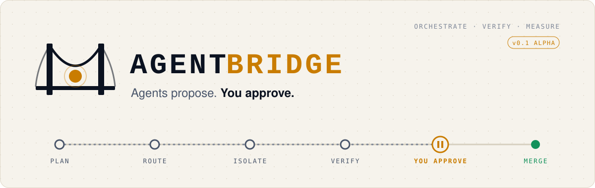
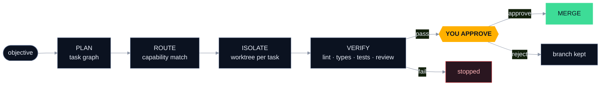
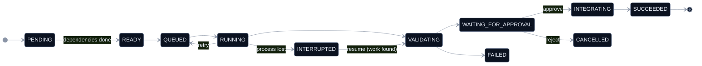

<p align="center">
  <picture>
    <source media="(prefers-color-scheme: dark)" srcset="https://raw.githubusercontent.com/yoonjae26/AgentBridge/main/assets/brand/banner-dark.svg">
    
  </picture>
</p>

<p align="center">
  <a href="https://github.com/yoonjae26/AgentBridge/actions/workflows/tests.yml"></a>
  <a href="https://github.com/yoonjae26/AgentBridge/actions/workflows/ci.yml"></a>
  
  
  <a href="LICENSE"></a>
</p>

<p align="center">
  <b><a href="#start">Start</a></b> &nbsp;·&nbsp;
  <b><a href="#account">Your account</a></b> &nbsp;·&nbsp;
  <b><a href="#track">The track</a></b> &nbsp;·&nbsp;
  <b><a href="#dashboard">Dashboard</a></b> &nbsp;·&nbsp;
  <b><a href="#bench">AgentBench</a></b> &nbsp;·&nbsp;
  <b><a href="#docs">Docs</a></b>
</p>

<br>

> **AgentBridge is a control tower for AI coding agents.** It plans the work, hands
> each task to the right agent, keeps every agent on its own branch, checks the result
> itself, and then **stops at a red signal until you say go.**

<br>

## The three rules

<table>
<tr>
<td width="33%" valign="top">

**`01` The agent never merges.**<br>
Every task lives in its own git worktree. Nothing reaches your branch until you run
`tasks approve`. No force-push, no reset, no deleted branches, ever.

</td>
<td width="33%" valign="top">

**`02` "Done!" is not evidence.**<br>
AgentBridge runs lint, type checks, tests and a diff review **itself**, and can lock
those checks inside a Docker sandbox with no network.

</td>
<td width="33%" valign="top">

**`03` A crash is not a restart.**<br>
Every transition is written to SQLite. After a crash, interrupted work is detected and
resumed safely, never blindly re-run.

</td>
</tr>
</table>

And one honest question: **does multi-agent collaboration actually beat a single
agent?** [AgentBench](#bench) exists to measure it, not to assume it.

<a id="start"></a>

## Start in a minute

```bash
pip install agentbridge-core       # the agentbridge command
pip install agentbridge-bench      # optional: AgentBench (installs agentbridge-core too)
```

AgentBridge ships as two packages:

| Package | Command | What it is |
|---|---|---|
| **`agentbridge-core`** | `agentbridge` | The orchestrator you use day to day. |
| **`agentbridge-bench`** | `agentbridge-bench` | AgentBench, the evaluation harness. Installs `agentbridge-core` too. |

<details>
<summary>From source (for development)</summary>

```bash
git clone https://github.com/yoonjae26/AgentBridge.git
cd AgentBridge
python -m venv .venv
source .venv/bin/activate        # Windows: .venv\Scripts\activate
pip install -e ".[dev]" -e packages/agentbridge-bench
```

</details>

Then, inside **any** git repository with at least one commit:

```bash
agentbridge init                                   # writes agentbridge.yaml
agentbridge providers check                        # who is on duty?
agentbridge run "Add a hello() function" --provider mock
agentbridge report <task_id>                       # what changed, what passed
agentbridge tasks approve <task_id>                # green signal: merge
```

The built-in `mock` provider needs no account. Requirements: Python 3.12+, Git 2.38+.

<a id="account"></a>

## Bring your own account

> [!IMPORTANT]
> This repository ships **no accounts, tokens or API keys**. Everyone runs AgentBridge
> with **their own** Claude subscription (Pro/Max) or their own Anthropic API key, and
> usage is billed to that account. `agentbridge.yaml`, `.env` and `.agentbridge/` are
> git-ignored so credentials never get committed.

**On your machine.** Install [Claude Code](https://docs.anthropic.com/en/docs/claude-code),
run `claude` once and log in with your account (or set `ANTHROPIC_API_KEY`). Then
`agentbridge providers check` should show `claude … available`, and `--provider claude`
does the rest. AgentBridge only checks that credentials *exist*; it never reads or
stores them.

<details>
<summary><b>In a locked-down container</b> (recommended for untrusted tasks)</summary>
<br>

The container sees only the task worktree: no `~/.claude`, no home directory, no other
environment variables. The root filesystem is read-only, all capabilities are dropped,
and the container is deleted after each run.

1. Build the image (Docker; on Windows, Docker inside WSL works):
   ```bash
   docker build -t agentbridge-claude:latest -f examples/container/Dockerfile.claude examples/container
   ```
2. Create a token for **your** account with `claude setup-token`. Anyone holding it can
   spend your quota, so treat it like a password.
3. Keep it in the current shell only, so it disappears when the window closes:
   ```powershell
   $env:CLAUDE_CODE_OAUTH_TOKEN = Read-Host -MaskInput "Claude token"   # PowerShell
   ```
   ```bash
   read -rs CLAUDE_CODE_OAUTH_TOKEN && export CLAUDE_CODE_OAUTH_TOKEN    # bash / zsh
   ```
4. Switch it on in your local `agentbridge.yaml` (the token never goes here):
   ```yaml
   providers:
     claude:
       container:
         enabled: true
         command: [docker]                  # Windows + WSL: [wsl, docker]
         token_env: CLAUDE_CODE_OAUTH_TOKEN # or ANTHROPIC_API_KEY
   ```

If Docker or the token is missing, AgentBridge refuses to run instead of falling back
to the host. Full privacy model: [docs/security.md](docs/security.md#running-claude-code-in-a-container).

</details>

<a id="track"></a>

## The track

Every objective travels the same line. The only stop that needs a human is the one
that matters.



| Station | What happens |
|---|---|
| **Plan** | The objective becomes a dependency graph (single, standard, or an agent-written JSON plan). |
| **Route** | Each task goes to a provider that *declares* the capability it needs: mock, Claude Code, Google Antigravity (manual handoff) or any CLI agent. |
| **Isolate** | One git worktree and branch per task. Overlapping edits and merge conflicts are detected before they hurt. |
| **Verify** | Diff, scope, Ruff, Mypy, Pytest and a heuristic review, optionally in a no-network Docker sandbox. |
| **You approve** | `tasks approve` / `tasks reject`, from the CLI or the dashboard. |
| **Merge** | Only into a clean checkout on the right branch, after a conflict-free dry run. |

<details>
<summary><b>State machine</b></summary>



Invalid transitions are rejected in code, and every change is stored as an event.

</details>

<a id="dashboard"></a>

## Dashboard

```bash
pip install "agentbridge-core[dashboard]"   # FastAPI + Uvicorn
agentbridge dashboard                       # http://127.0.0.1:8765/
```

A local control room with live updates: task counts and the approval queue, run plans
and dependency graphs, coloured diffs, failing validation output, tokens and estimated
cost, and **Approve / Reject / Cancel** behind a confirmation. Localhost only; every
action needs a per-session token. [More](docs/dashboard.md).

<a id="bench"></a>

## AgentBench

> *Does multi-agent collaboration improve software-engineering task completion
> compared with a single agent, and when?*

12 deterministic tasks across 8 categories: bug fixing, features, refactoring, test
generation, docs, code review, dependency updates and repository analysis. Acceptance
tests stay **hidden** from the agent until it has finished. Published as the
[`agentbridge-bench`](packages/agentbridge-bench) package; `agentbridge benchmark …` runs
the same commands once it is installed.

```bash
agentbridge-bench run smoke -c mock-oracle -c mock-noop     # free harness check
agentbridge-bench run core  -c claude-single -c claude-multi -n 3
```

| Harness control | Runs | Success |
|---|---:|---:|
| `mock-oracle` writes the reference solution | 12 | **100 %** |
| `mock-noop` changes nothing useful | 12 | **0 %** |
| `antigravity-remote` manual handoff | 0 of 12 executable | n/a |

| Pilot · `bugfix-002` · n = 1 | Hidden tests | Time | Est. cost |
|---|---:|---:|---:|
| `claude-single` | 5/5 | 14.9 s | $0.37 |
| `claude-multi` analyst → developer → reviewer | 5/5 | 74.7 s | $0.75 |

> [!WARNING]
> One easy task, one repetition. **This is not a result.** Please don't cite single-
> vs multi-agent conclusions from this repository yet.
> [Methodology](docs/benchmark-methodology.md).

## Use it from your coding agent

The free [AgentBridge skill](skills/agentbridge) teaches Claude Code (or any agent that
supports Agent Skills) to delegate work through the CLI, read the JSON report and hand
you the approve / reject decision. It never approves on its own.

## Status

**Working** · CLI · SQLite state machine · mock and Claude Code adapters · worktree
isolation · validation engine · approval-gated merge · retries and recovery · Alembic
migrations · Docker validation sandbox · dashboard · AgentBench · 178 tests

**Partial** · Antigravity (manual handoff) · generic CLI adapter (user-declared
capabilities) · Claude in a container (unit-tested, not yet run end-to-end)

**Planned** · dedicated Codex / OpenCode adapters. See the [roadmap](docs/roadmap.md).

> [!CAUTION]
> A worktree isolates **changes**, not **processes**: on the host, agents run with your
> user's permissions. Use container mode or a VM for untrusted repositories.
> [Security model](docs/security.md).

<a id="docs"></a>

## Docs

| Start | Understand | Configure |
|---|---|---|
| [Installation](docs/installation.md) | [Architecture](docs/architecture.md) | [Configuration](docs/configuration.md) |
| [Examples](examples/) | [Task lifecycle](docs/task-lifecycle.md) | [Providers](docs/providers.md) |
| [Troubleshooting](docs/troubleshooting.md) | [Security model](docs/security.md) | [Capability matrix](docs/provider-capabilities.md) |
| [Dashboard](docs/dashboard.md) | [Benchmark method](docs/benchmark-methodology.md) | [Roadmap](docs/roadmap.md) · [Releasing](docs/releasing.md) |

<details>
<summary><b>Repository layout</b></summary>

```text
src/agentbridge/
├── cli/          commands, output, exit codes
├── config/       validated agentbridge.yaml
├── core/         orchestrator, planner, router, events
├── agents/       adapter contract: mock, claude, antigravity, generic_cli
├── tasks/        models, state machine, dependencies, recovery
├── storage/      SQLite (WAL) + Alembic migrations
├── workspace/    worktrees, diffs, conflicts, approval-gated merge
├── validation/   test / lint / type runners, diff review, sandbox
├── security/     policies, command allowlist, secret redaction
└── dashboard/    FastAPI server + prebuilt React UI
packages/agentbridge-bench/
                  AgentBench (agentbridge_bench): runner, metrics, reports, CLI
benchmarks/       tasks, configurations, published reports
dashboard/        React + TypeScript source
```

</details>

**Contributing:** `make install` sets up both packages; `make check` runs Ruff, Mypy (strict) and Pytest. Read
[CONTRIBUTING.md](CONTRIBUTING.md) and the [Code of Conduct](CODE_OF_CONDUCT.md);
report vulnerabilities privately via [SECURITY.md](SECURITY.md). Licensed under
[MIT](LICENSE).

<br>

<p align="center">
  <br>
  <sub><b>AGENTBRIDGE</b> &nbsp;·&nbsp; built by <a href="https://github.com/yoonjae26">yoonjae26</a></sub><br>
  <sub>Agents propose. You approve.</sub>
</p>
