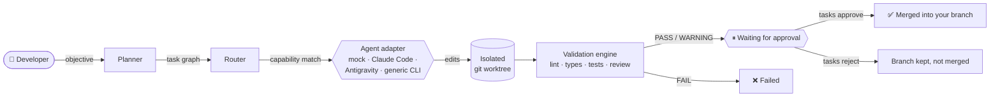
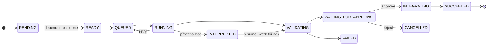

<div align="center">

# 🌉 AgentBridge

### One interface. Multiple AI agents. Reliable software delivery.

Plan, dispatch, isolate, validate and approve the work of AI coding agents —
and measure whether multi-agent collaboration actually helps.

[](https://github.com/yoonjae26/AgentBridge/actions/workflows/tests.yml)
[](https://github.com/yoonjae26/AgentBridge/actions/workflows/ci.yml)


[](LICENSE)


[Quick start](#-quick-start) •
[Features](#-features) •
[How it works](#-how-it-works) •
[Dashboard](#-dashboard) •
[AgentBench](#-agentbench) •
[Docs](#-documentation)

</div>

---

## ✨ Why AgentBridge?

Coding agents are powerful, but working with several of them is messy: different
CLIs, copy-pasted prompts, agents overwriting each other, lost state after a crash,
and "done!" claims nobody checked. AgentBridge sits between you and your agents:

| | |
|---|---|
| 🧭 **Plan & route** | Turns an objective into a dependency graph of tasks and sends each to a provider that *declares* the capabilities it needs. |
| 🌿 **Isolate** | Every task runs in its own git worktree and branch. Your checkout is never touched. |
| 🔍 **Verify** | Never trusts the agent: AgentBridge runs lint, type checks, tests and a diff review itself. |
| ✋ **You approve** | Nothing is merged until you say so. No force-push, no reset, no deleted branches. |
| 💾 **Recover** | State lives in SQLite; interrupted tasks are detected and resumed safely, never blindly re-run. |
| 📊 **Measure** | AgentBench compares single- and multi-agent setups on reproducible tasks, with honest `n/a` for missing data. |

> [!NOTE]
> **v0.1.0 — alpha.** Everything listed as ✅ below is implemented and covered by the
> test suite (166 tests). See the [roadmap](docs/roadmap.md) for what is not done yet.

## 🚀 Quick start

**Requirements:** Python 3.12+, Git 2.38+. Claude Code is optional — the built-in mock
provider needs no account.

```bash
git clone https://github.com/yoonjae26/AgentBridge.git
cd AgentBridge
python -m venv .venv
source .venv/bin/activate          # Windows: .venv\Scripts\activate
pip install -e ".[dev]"
```

Then, inside **any** git repository with at least one commit:

```bash
agentbridge init                                                       # create agentbridge.yaml
agentbridge providers check                                            # what is available?
agentbridge run "Create a Python hello world function" --provider mock # plan → run → validate
agentbridge tasks list
agentbridge report <task_id>                                           # what changed, what passed
agentbridge tasks approve <task_id>                                    # merge — only when you decide
```

<details>
<summary><b>Using Claude Code instead of the mock provider</b></summary>

1. Install [Claude Code](https://docs.anthropic.com/en/docs/claude-code) and log in once (`claude`).
2. `agentbridge providers check` should report `claude … available`.
3. Run with `--provider claude`, or set `routing.default_worker: claude` in `agentbridge.yaml`.

AgentBridge calls `claude -p --output-format json --permission-mode acceptEdits` inside
the task worktree, sends the prompt on stdin and records tokens and the CLI's
*estimated* cost.

</details>

## 🧩 Features

| Area | Status |
|---|---|
| CLI: `init`, `providers`, `run`, `tasks`, `logs`, `report`, `remote`, `benchmark`, `dashboard` | ✅ |
| SQLite persistence (WAL), explicit state machine, full event history | ✅ |
| Mock provider: success, failure, delay, interrupt, invalid output, unavailable | ✅ |
| Claude Code adapter | ✅ verified with Claude Code 2.1.303 |
| Git worktree per task, diff capture, overlap & merge-conflict detection | ✅ |
| Validation: diff, scope, isolation, Ruff, Mypy, Pytest, heuristic review | ✅ |
| Approval-gated merge | ✅ |
| Planner (single / standard / provider JSON plan) and dependency scheduling | ✅ |
| Retries with exponential backoff, cancellation, restart recovery | ✅ |
| Local web dashboard with live updates | ✅ |
| AgentBench: 12 tasks, 8 categories, JSON / CSV / Markdown / SVG reports | ✅ |
| Google Antigravity remote agents | ⚠️ manual handoff only — no automated execution |
| Generic CLI adapter for other agents | ⚠️ capabilities are user-declared |
| Docker isolation, dedicated Codex/OpenCode adapters, Alembic migrations | ❌ planned |

## ⚙️ How it works



Every task follows an explicit state machine; invalid transitions are rejected and
every change is recorded:



<details>
<summary><b>Repository layout</b></summary>

```text
src/agentbridge/
├── cli/          Typer commands, Rich output, exit codes
├── config/       validated agentbridge.yaml models
├── core/         orchestrator, planner, router, events
├── agents/       adapter contract + mock, claude, antigravity, generic_cli
├── tasks/        task models, state machine, dependencies, recovery
├── storage/      SQLAlchemy models and data access (SQLite, WAL)
├── workspace/    git worktrees, diffs, conflicts, approval-gated merge
├── validation/   test / lint / type-check runners, diff review
├── security/     policies, command permissions, secret redaction, paths
├── reporting/    task and run reports
├── dashboard/    FastAPI server + prebuilt React UI
└── bench/        AgentBench runner, metrics, reports
benchmarks/       AgentBench tasks, configurations, published reports
dashboard/        React + TypeScript source of the web UI
docs/             full documentation
```

</details>

## 🖥️ Dashboard

```bash
agentbridge dashboard        # opens http://127.0.0.1:8765/
```

- **Overview** — task counts, approval banner, recent runs, live activity feed, providers
- **Runs** — objective, plan warnings, task dependency graph
- **Tasks** — coloured diff, validation steps with failing output, agent output,
  timeline, tokens & cost, and **Approve / Reject / Cancel** with confirmation
- **AgentBench** — success-rate bars and full metric tables

The server listens on localhost only and actions require a per-session token.
See [docs/dashboard.md](docs/dashboard.md).

## 📊 AgentBench

> *Does multi-agent collaboration improve software-engineering task completion
> compared with individual agents — and when?*

12 deterministic tasks covering bug fixing, features, refactoring, test generation,
documentation, code review, dependency updates and repository analysis. Acceptance
tests stay **hidden** from the agent until it has finished.

```bash
agentbridge benchmark list
agentbridge benchmark run smoke -c mock-oracle -c mock-noop     # free harness check
agentbridge benchmark run core  -c claude-single -c claude-multi -n 3
```

| Harness control (real run) | Runs | Task success |
|---|---:|---:|
| `mock-oracle` — writes the reference solution | 12 | **100 %** |
| `mock-noop` — changes nothing useful | 12 | **0 %** |
| `antigravity-remote` — manual handoff | 0 (12 not executable) | n/a |

> [!IMPORTANT]
> These controls only prove the harness works. **No real-agent comparison has been
> published yet** — please don't cite multi- vs single-agent conclusions from this
> repository until it has. Method: [docs/benchmark-methodology.md](docs/benchmark-methodology.md).

## 🔐 Security at a glance

- Agent output, plans and repository content are **never executed**.
- Only configured commands run, without a shell, through a per-policy allowlist
  (`safe` / `standard` / `trusted`).
- Force-push, hard reset, `git clean` and branch deletion are refused in code.
- Secrets are redacted from logs, reports, stored diffs and the database.
- Merges require a clean checkout, the right branch and a conflict-free dry run.

> [!WARNING]
> A git worktree isolates **changes**, not **processes**: agents run with your user's
> permissions. Use a container or VM for untrusted repositories. Details in
> [docs/security.md](docs/security.md).

## 📚 Documentation

| Getting started | Concepts | Reference |
|---|---|---|
| [Installation](docs/installation.md) | [Architecture](docs/architecture.md) | [Configuration](docs/configuration.md) |
| [Examples](examples/) | [Task lifecycle](docs/task-lifecycle.md) | [Providers](docs/providers.md) |
| [Troubleshooting](docs/troubleshooting.md) | [Security model](docs/security.md) | [Capability matrix](docs/provider-capabilities.md) |
| [Dashboard](docs/dashboard.md) | [Benchmark methodology](docs/benchmark-methodology.md) | [Roadmap](docs/roadmap.md) |

## 🛠️ Development

```bash
make check         # ruff + format check + mypy (strict) + pytest
make test          # tests only
make bench-smoke   # AgentBench harness controls
```

Contributions are welcome — please read [CONTRIBUTING.md](CONTRIBUTING.md) and the
[Code of Conduct](CODE_OF_CONDUCT.md). Report vulnerabilities privately as described
in [SECURITY.md](SECURITY.md).

## 📄 License

[MIT](LICENSE). Runtime dependencies (Typer, Rich, Pydantic, SQLAlchemy, PyYAML,
FastAPI, Uvicorn, React) are MIT- or BSD-licensed.

<div align="center">
<sub>Don't just connect AI agents. Make them cooperate, verify their work, and measure
whether the collaboration actually improves software engineering.</sub>
</div>
