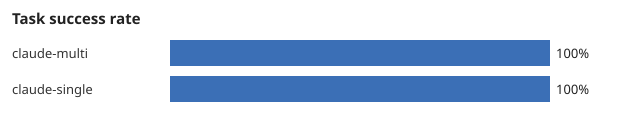
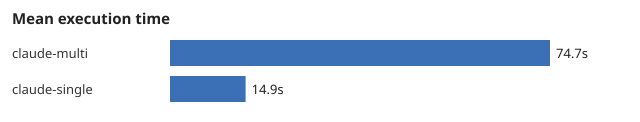

# AgentBench report: exp-20261107-170916-ab11

- Generated by AgentBridge 0.1.0
- Started: 2026-11-07T17:09:16+00:00; finished: 2026-11-07T17:10:49+00:00
- Suite: bugfix-002; repetitions: 1
- Platform: Windows-11-10.0.26300-SP0; Python 3.12.7; git version 2.53.0.windows.2

> These numbers come only from the records in `records/`. Unavailable metrics are
> shown as n/a, never as zero. Control configurations (`mock-*`) validate the
> harness itself and say nothing about AI agent quality.

## Summary by configuration

| Metric | claude-multi | claude-single |
|---|---|---|
| Runs executed | 1 | 1 |
| Runs not executable | 0 | 0 |
| Task success rate | 1 | 1 |
| Hidden test pass rate | 1 | 1 |
| Mean execution time (s) | 74.72 | 14.86 |
| Median execution time (s) | 74.72 | 14.86 |
| Measured cost (USD) | n/a | n/a |
| Estimated cost (USD) | 0.7462 | 0.3749 |
| Input tokens | 473102 | 227093 |
| Output tokens | 4717 | 1214 |
| Regression rate | 0 | 0 |
| Retries per run | 0 | 0 |
| Failure rate | 0 | 0 |
| Human interventions | 0 | 0 |
| Merge success rate | 1 | 1 |





## Per-run results

| Task | Configuration | Rep | Status | Hidden tests | Time (s) | Regression | Merge | Est. cost |
|---|---|---|---|---|---|---|---|---|
| bugfix-002 | claude-multi | 1 | completed | 5/5 | 74.72 | False | True | 0.7462 |
| bugfix-002 | claude-single | 1 | completed | 5/5 | 14.86 | False | True | 0.3749 |

## Reproducibility

```json
{
  "experiment_id": "exp-20261107-170916-ab11",
  "suite": "bugfix-002",
  "tasks": [
    "bugfix-002"
  ],
  "configurations": {
    "claude-single": {
      "name": "claude-single",
      "description": "Configuration A: single Claude Code agent (Task -> Claude Code -> Result).",
      "kind": "single_agent",
      "planner_mode": "single",
      "providers": {
        "claude": {
          "enabled": true,
          "type": "claude_code",
          "execution_mode": null,
          "command": "claude",
          "model": null,
          "timeout_seconds": null,
          "permission_mode": "acceptEdits",
          "allowed_tools": [],
          "extra_args": [],
          "git_remote": "origin",
          "args": [],
          "capabilities": [],
          "scenario": "success",
          "delay_seconds": 0.0,
          "files": {},
          "container": {
            "enabled": false,
            "command": [
              "docker"
            ],
            "image": "agentbridge-claude:latest",
            "token_env": "CLAUDE_CODE_OAUTH_TOKEN",
            "memory": "4g",
            "cpus": 2.0,
            "pids_limit": 512,
            "disallowed_tools": [
              "Bash",
              "WebFetch",
              "WebSearch"
            ]
          }
        }
      },
      "routing": {
        "planner": "claude",
        "default_worker": "claude",
        "reviewer": null,
        "roles": {}
      },
      "oracle": false
    },
    "claude-multi": {
      "name": "claude-multi",
      "description": "Multi-agent workflow using Claude Code in three roles: analyst -> developer -> reviewer (template plan), with an additional agent review of the developer diff.",
      "kind": "multi_agent",
      "planner_mode": "standard",
      "providers": {
        "claude": {
          "enabled": true,
          "type": "claude_code",
          "execution_mode": null,
          "command": "claude",
          "model": null,
          "timeout_seconds": null,
          "permission_mode": "acceptEdits",
          "allowed_tools": [],
          "extra_args": [],
          "git_remote": "origin",
          "args": [],
          "capabilities": [],
          "scenario": "success",
          "delay_seconds": 0.0,
          "files": {},
          "container": {
            "enabled": false,
            "command": [
              "docker"
            ],
            "image": "agentbridge-claude:latest",
            "token_env": "CLAUDE_CODE_OAUTH_TOKEN",
            "memory": "4g",
            "cpus": 2.0,
            "pids_limit": 512,
            "disallowed_tools": [
              "Bash",
              "WebFetch",
              "WebSearch"
            ]
          }
        }
      },
      "routing": {
        "planner": "claude",
        "default_worker": "claude",
        "reviewer": "claude",
        "roles": {}
      },
      "oracle": false
    }
  },
  "repetitions": 1,
  "started_at": "2026-11-07T17:09:16+00:00",
  "agentbridge_version": "0.1.0",
  "python": "3.12.7",
  "platform": "Windows-11-10.0.26300-SP0",
  "git": "git version 2.53.0.windows.2",
  "finished_at": "2026-11-07T17:10:49+00:00"
}
```
