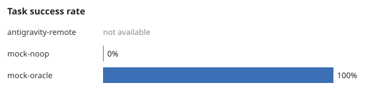
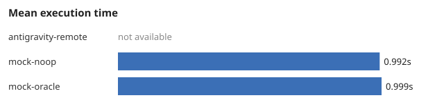

# AgentBench report: exp-20261107-150522-30d0

- Generated by AgentBridge 0.1.0
- Started: 2026-11-07T15:05:22+00:00; finished: 2026-11-07T15:06:15+00:00
- Suite: core; repetitions: 1
- Platform: Windows-11-10.0.26300-SP0; Python 3.12.7; git version 2.53.0.windows.2

> These numbers come only from the records in `records/`. Unavailable metrics are
> shown as n/a, never as zero. Control configurations (`mock-*`) validate the
> harness itself and say nothing about AI agent quality.

## Summary by configuration

| Metric | antigravity-remote | mock-noop | mock-oracle |
|---|---|---|---|
| Runs executed | 0 | 12 | 12 |
| Runs not executable | 12 | 0 | 0 |
| Task success rate | n/a | 0 | 1 |
| Hidden test pass rate | n/a | 0.2712 | 1 |
| Mean execution time (s) | n/a | 0.992 | 0.999 |
| Median execution time (s) | n/a | 0.985 | 1 |
| Measured cost (USD) | n/a | n/a | n/a |
| Estimated cost (USD) | n/a | n/a | n/a |
| Input tokens | n/a | n/a | n/a |
| Output tokens | n/a | n/a | n/a |
| Regression rate | n/a | 0 | 0 |
| Retries per run | n/a | 0 | 0 |
| Failure rate | n/a | 0 | 0 |
| Human interventions | n/a | 0 | 0 |
| Merge success rate | n/a | 1 | 1 |





## Per-run results

| Task | Configuration | Rep | Status | Hidden tests | Time (s) | Regression | Merge | Est. cost |
|---|---|---|---|---|---|---|---|---|
| analysis-001 | antigravity-remote | 1 | not_executable (provider 'antigravity' requires a manual remote handoff) | n/a | n/a | n/a | n/a | n/a |
| analysis-001 | mock-noop | 1 | completed | 0/4 | 0.985 | False | True | n/a |
| analysis-001 | mock-oracle | 1 | completed | 4/4 | 1.031 | False | True | n/a |
| bugfix-001 | antigravity-remote | 1 | not_executable (provider 'antigravity' requires a manual remote handoff) | n/a | n/a | n/a | n/a | n/a |
| bugfix-001 | mock-noop | 1 | completed | 2/4 | 0.984 | False | True | n/a |
| bugfix-001 | mock-oracle | 1 | completed | 4/4 | 1 | False | True | n/a |
| bugfix-002 | antigravity-remote | 1 | not_executable (provider 'antigravity' requires a manual remote handoff) | n/a | n/a | n/a | n/a | n/a |
| bugfix-002 | mock-noop | 1 | completed | 2/5 | 1 | False | True | n/a |
| bugfix-002 | mock-oracle | 1 | completed | 5/5 | 1 | False | True | n/a |
| bugfix-003 | antigravity-remote | 1 | not_executable (provider 'antigravity' requires a manual remote handoff) | n/a | n/a | n/a | n/a | n/a |
| bugfix-003 | mock-noop | 1 | completed | 1/5 | 1.015 | False | True | n/a |
| bugfix-003 | mock-oracle | 1 | completed | 5/5 | 1 | False | True | n/a |
| deps-001 | antigravity-remote | 1 | not_executable (provider 'antigravity' requires a manual remote handoff) | n/a | n/a | n/a | n/a | n/a |
| deps-001 | mock-noop | 1 | completed | 1/3 | 0.984 | n/a | True | n/a |
| deps-001 | mock-oracle | 1 | completed | 3/3 | 1 | n/a | True | n/a |
| docs-001 | antigravity-remote | 1 | not_executable (provider 'antigravity' requires a manual remote handoff) | n/a | n/a | n/a | n/a | n/a |
| docs-001 | mock-noop | 1 | completed | 2/6 | 0.984 | False | True | n/a |
| docs-001 | mock-oracle | 1 | completed | 6/6 | 1 | False | True | n/a |
| feature-001 | antigravity-remote | 1 | not_executable (provider 'antigravity' requires a manual remote handoff) | n/a | n/a | n/a | n/a | n/a |
| feature-001 | mock-noop | 1 | completed | 0/1 | 1 | False | True | n/a |
| feature-001 | mock-oracle | 1 | completed | 16/16 | 1.016 | False | True | n/a |
| feature-002 | antigravity-remote | 1 | not_executable (provider 'antigravity' requires a manual remote handoff) | n/a | n/a | n/a | n/a | n/a |
| feature-002 | mock-noop | 1 | completed | 0/5 | 0.985 | n/a | True | n/a |
| feature-002 | mock-oracle | 1 | completed | 5/5 | 0.984 | n/a | True | n/a |
| feature-003 | antigravity-remote | 1 | not_executable (provider 'antigravity' requires a manual remote handoff) | n/a | n/a | n/a | n/a | n/a |
| feature-003 | mock-noop | 1 | completed | 0/13 | 0.984 | False | True | n/a |
| feature-003 | mock-oracle | 1 | completed | 13/13 | 0.984 | False | True | n/a |
| refactor-001 | antigravity-remote | 1 | not_executable (provider 'antigravity' requires a manual remote handoff) | n/a | n/a | n/a | n/a | n/a |
| refactor-001 | mock-noop | 1 | completed | 2/3 | 1.016 | False | True | n/a |
| refactor-001 | mock-oracle | 1 | completed | 3/3 | 1 | False | True | n/a |
| review-001 | antigravity-remote | 1 | not_executable (provider 'antigravity' requires a manual remote handoff) | n/a | n/a | n/a | n/a | n/a |
| review-001 | mock-noop | 1 | completed | 1/3 | 0.969 | n/a | True | n/a |
| review-001 | mock-oracle | 1 | completed | 3/3 | 0.969 | n/a | True | n/a |
| tests-001 | antigravity-remote | 1 | not_executable (provider 'antigravity' requires a manual remote handoff) | n/a | n/a | n/a | n/a | n/a |
| tests-001 | mock-noop | 1 | completed | 5/7 | 1 | n/a | True | n/a |
| tests-001 | mock-oracle | 1 | completed | 7/7 | 1 | n/a | True | n/a |

## Reproducibility

```json
{
  "experiment_id": "exp-20261107-150522-30d0",
  "suite": "core",
  "tasks": [
    "analysis-001",
    "bugfix-001",
    "bugfix-002",
    "bugfix-003",
    "deps-001",
    "docs-001",
    "feature-001",
    "feature-002",
    "feature-003",
    "refactor-001",
    "review-001",
    "tests-001"
  ],
  "configurations": {
    "mock-oracle": {
      "name": "mock-oracle",
      "description": "Harness control. The mock provider writes the task's reference solution, so every task should pass. Validates fixtures and hidden tests; says nothing about AI agents.",
      "kind": "control",
      "planner_mode": "single",
      "providers": {
        "mock": {
          "enabled": true,
          "type": "mock",
          "execution_mode": null,
          "command": null,
          "model": null,
          "timeout_seconds": null,
          "permission_mode": null,
          "allowed_tools": [],
          "extra_args": [],
          "git_remote": "origin",
          "args": [],
          "capabilities": [],
          "scenario": "success",
          "delay_seconds": 0.0,
          "files": {}
        }
      },
      "routing": {
        "planner": "mock",
        "default_worker": "mock",
        "reviewer": null,
        "roles": {}
      },
      "oracle": true
    },
    "mock-noop": {
      "name": "mock-noop",
      "description": "Negative control. The mock provider writes an unrelated file, so tasks should fail. Confirms the hidden tests cannot be passed without a change.",
      "kind": "control",
      "planner_mode": "single",
      "providers": {
        "mock": {
          "enabled": true,
          "type": "mock",
          "execution_mode": null,
          "command": null,
          "model": null,
          "timeout_seconds": null,
          "permission_mode": null,
          "allowed_tools": [],
          "extra_args": [],
          "git_remote": "origin",
          "args": [],
          "capabilities": [],
          "scenario": "success",
          "delay_seconds": 0.0,
          "files": {}
        }
      },
      "routing": {
        "planner": "mock",
        "default_worker": "mock",
        "reviewer": null,
        "roles": {}
      },
      "oracle": false
    },
    "antigravity-remote": {
      "name": "antigravity-remote",
      "description": "Configuration B: single Antigravity remote agent (manual handoff).",
      "kind": "remote",
      "planner_mode": "single",
      "providers": {
        "antigravity": {
          "enabled": true,
          "type": "antigravity_remote",
          "execution_mode": null,
          "command": "agy",
          "model": null,
          "timeout_seconds": null,
          "permission_mode": null,
          "allowed_tools": [],
          "extra_args": [],
          "git_remote": "origin",
          "args": [],
          "capabilities": [],
          "scenario": "success",
          "delay_seconds": 0.0,
          "files": {}
        }
      },
      "routing": {
        "planner": "antigravity",
        "default_worker": "antigravity",
        "reviewer": null,
        "roles": {}
      },
      "oracle": false
    }
  },
  "repetitions": 1,
  "started_at": "2026-11-07T15:05:22+00:00",
  "agentbridge_version": "0.1.0",
  "python": "3.12.7",
  "platform": "Windows-11-10.0.26300-SP0",
  "git": "git version 2.53.0.windows.2",
  "finished_at": "2026-11-07T15:06:15+00:00"
}
```
